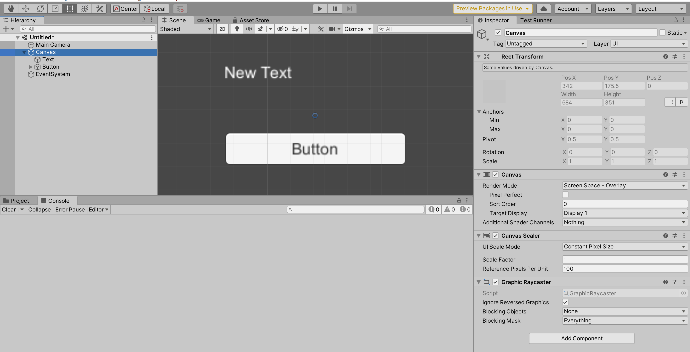
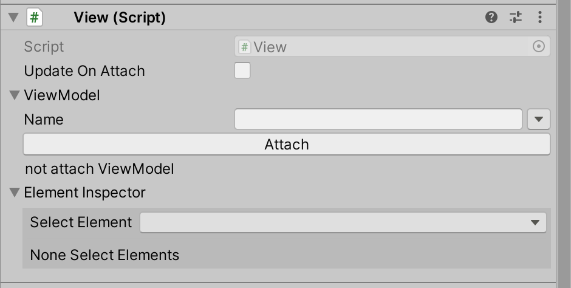
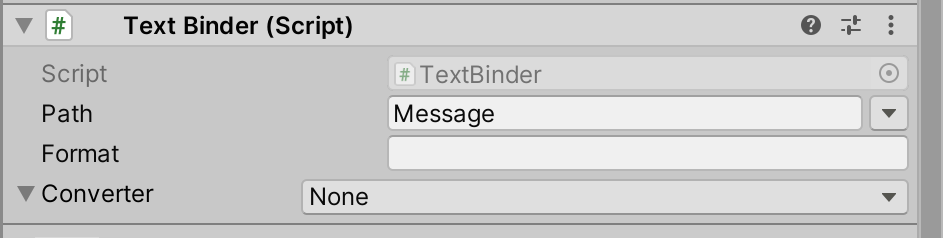
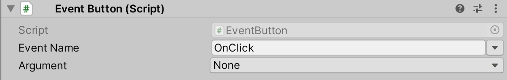
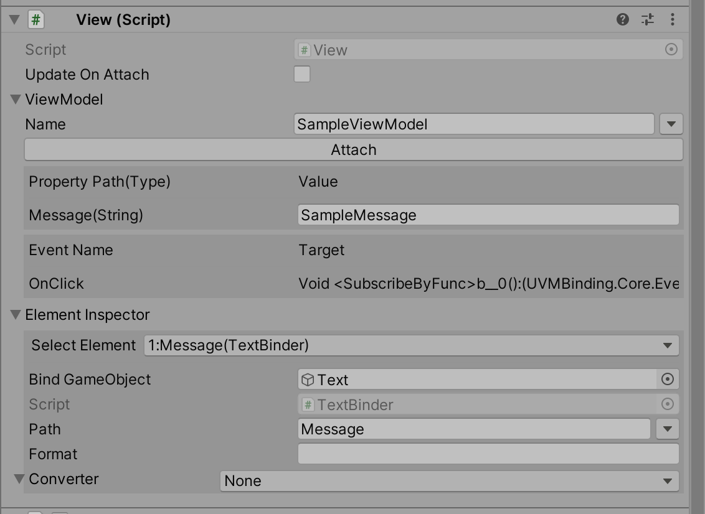

# UVMBinding (Unity ViewModel Binding)

Unity用のデータバインディングパッケージです。  
ViewModelを介してViewの更新を行います。  
この手のデータバインディングを行うパッケージはリフレクションを利用するケースが多いですがUVMBindingでは利用しません。  
また基本的な値の更新においてボックス化が発生しないようになっています。  

## 動作環境

Unity 6.3 (6000.3) 以降。  

## インストール

upmで以下のURLでパッケージのインストールが出来ます。  
```
https://github.com/yazawa-ichio/UVMBinding.git?path=Unity/Assets/UVMBinding
```

## 簡単な使用例

詳しい利用方法はドキュメントにまとめる予定です。  

### ViewModelを作成する
データバインディング用のデータはViewModelクラスを継承して実装します。  

```cs
using UVMBinding;

public class SampleViewModel : ViewModel
{
	public string Message
	{
		get => GetImpl<string>("Message");
		set => SetImpl("Message", value);
	}

	public event System.Action OnClick
	{
		add => Event.Subscribe("OnClick", value);
		remove => Event.Unsubscribe("OnClick", value);
	}
}
```

ILPostProcessorを利用してViewModelを簡易に記述する事が出来ます。  
基本的にはこちらの記述の方を推奨します。  
※MLAPI等で使われていますがUnityがまだ実験的な機能として提供しているものなのでUnityのバージョンアップ等で破壊的な変更が入る可能性があります。

```cs
using UVMBinding;

public class SampleViewModel : ViewModel
{
	[Bind]
	public string Message { get; set; } = "Default Message";
	[Event]
	public System.Action OnClick { get; set; }
}
```

### Viewを作成する

UVMBindingにおけるViewはGameObjectになります。  
View毎にスクリプトを書くことはありません。  
ViewModelから値を受け取り反映を行うBinderを組み合わせて作成します。  

1. TextとButtonを持つUIを作成


2. ViewのルートにViewのComponent追加


3. TextにTextBinderを追加しPathに`Message`を設定


4. ButtonにEventButtonを追加しNameに`OnClick`を設定


### ViewにViewModelをアタッチする
以下のようにAttach関数かViewModelプロパティにViewModelを設定すると表示が更新されます。  
以後はOnClickのイベントの用にViewModelの値を変更すれば表示に反映されます。

```cs
using UVMBinding;
using UnityEngine;

public class SampleViewModelTest : MonoBehaviour
{
	void Start()
	{
		GetComponent<View>().Attach<SampleViewModel>(vm => {
			vm.Message = "SampleMessage";
			vm.OnClick = () => vm.Message = "Clicked";
		});
	}
}
```

実行中にアタッチされているViewModelの情報などはViewComponentから確認できます。


## 行の回収を待たせる

`CollectionBinder`は削除された行を即座に非activeにしてプールへ戻します。  
退場アニメーションなどを挟む場合は`OnBeforeReleaseAsync`を継承先で実装します。  

```cs
protected virtual Task OnBeforeReleaseAsync(GameObject instance, IViewModel model, CancellationToken cancellationToken)
```

既定の実装は`Task.CompletedTask`を返すため、実装しない限り従来どおり即座に回収します。  
同期的に完了したTaskを返した場合もフレームを跨がずに回収します。  

- 呼ばれるのは行が削除された時だけです。並べ替えや同じ行の更新では呼ばれません。同じViewModelが複数行にある場合は、削除された実体ごとに呼ばれます。
- 兄弟順の詰め直しより前に呼ばれるため、`instance.transform.GetSiblingIndex()`で削除前の位置を同期的に取得できます。
- 待機中の行は非activeにならず、他のViewModelへ再利用されません。有効行としても扱われないため、コレクションへの追加・並べ替えは待たずに進みます。複数行の削除は同時に待機します。
- 待機に入った時点で行のViewは`ViewModel`から切り離されます（`IViewModel.OnUnbind`まで通ります）。待機中の行は以後更新されないため、**削除が画面へ反映された後であれば、待機の有無にかかわらず利用側はViewModelをDisposeできます**。即時回収の場合と同じ時点です。ViewModelの所有権は従来どおり利用側にあり、Binderが破棄することはありません。フックの引数`model`は削除された行が参照していたViewModelで、どの行が消えたかを識別するために渡しています。待機中に参照し続ける前提では使わないでください。
- Bindingの解除・GameObjectの非active化・破棄の際は`cancellationToken`へ取消を通知し、待たずにその場で回収します。取消に応じない処理が残っていても終了は待ちません。遅れて完了しても回収は一度だけです。
- フックが例外を投げた場合・Taskが失敗した場合はエラーログを出したうえで回収します。行が残留することはありません。

```cs
using System.Threading;
using System.Threading.Tasks;
using UnityEngine;
using UVMBinding;
using UVMBinding.Binders;

public class AnimatedCollectionBinder : CollectionBinder
{
	protected override Task OnBeforeReleaseAsync(GameObject instance, IViewModel model, CancellationToken cancellationToken)
	{
		if (!instance.TryGetComponent<IHideAnimation>(out var animation))
		{
			return Task.CompletedTask;
		}
		return animation.Hide(instance.transform.GetSiblingIndex(), cancellationToken);
	}
}
```

## 検査

ViewとViewModelの結線を静的に検査します。  
存在しないパスへのバインドや、変換できない型の組み合わせなどを実行前に見つけられます。  
`UVMBinding/Lint/Run` から実行します。  

## 出力パッケージ（任意）

Viewの構造をHTML・JSON・C#ソースとして書き出す別パッケージです。  
本体には含まれないため、必要な場合のみインストールしてください。  

```
https://github.com/yazawa-ichio/UVMBinding.git?path=Unity/Assets/UVMBinding.Export
```

`UVMBinding/Export HTML/Active Scene` で開いているシーンを書き出します。  
既定ではエディタ専用で、プレイヤーのビルドには含まれません。  
実行中の画面を書き出す場合は `UVMBINDING_EXPORT` を定義してください。  
